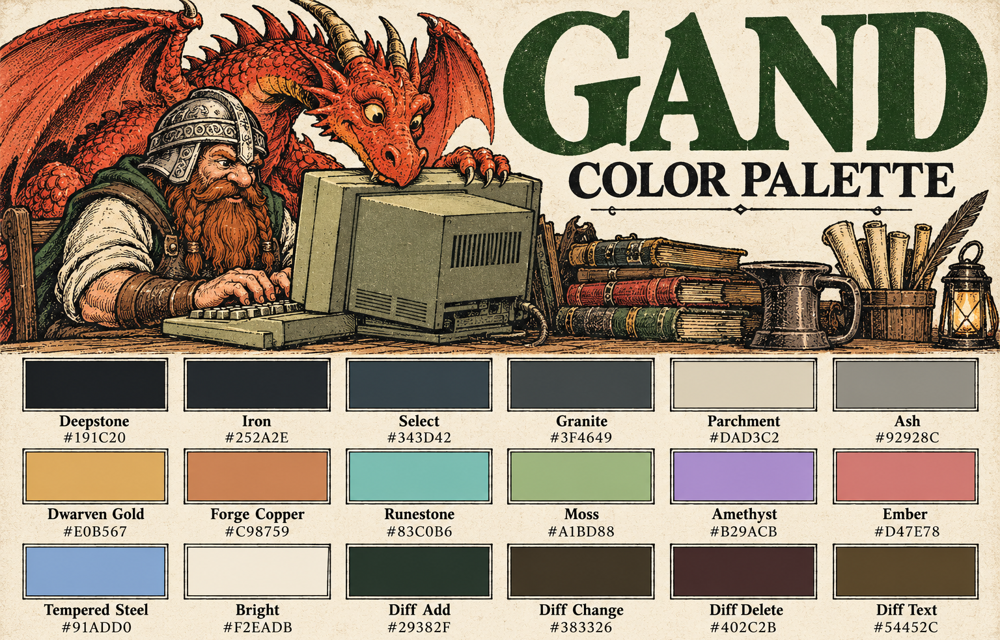

# 🏔️ Gand

A color palette inspired by Gand, the dwarf I played in fantasy games growing up.
Whenever a game let me play a dwarf, I played Gand.



## 📦 Installation

### lazy.nvim

Add this plugin spec to your lazy.nvim configuration:

```lua
{
  "MattBortoletto/gand.nvim",
  lazy = false,
  priority = 1000,
  config = function()
    vim.cmd.colorscheme("gand")
  end,
}
```

### LazyVim

Create `~/.config/nvim/lua/plugins/gand.lua` with:

```lua
return {
  { "MattBortoletto/gand.nvim", lazy = false, priority = 1000 },
  { "LazyVim/LazyVim", opts = { colorscheme = "gand" } },
}
```

Restart Neovim and run `:Lazy sync` to install Gand.

### Native Neovim packages

Add this to your `init.lua`:

```lua
vim.cmd.colorscheme("gand")
```

## Configuration

Call `setup()` before loading the colorscheme. All options below show the defaults:

```lua
require("gand").setup({
  variant = "dark", -- "dark" or "light"
  transparent = false,
  bold = true,
  italic = true,
  dim_inactive = false,
  styles = {
    comments = { italic = true },
    keywords = {}, -- e.g. { bold = true }
  },
  diagnostics = { style = "underline" }, -- "underline", "background", or "text"
})
vim.cmd.colorscheme("gand")
```

- `variant`: choose the original dark palette or a light palette with warm parchment backgrounds and deeper gold, copper, and rune accents. Sets Neovim's `background` to match.
- `transparent`: use the terminal background for editor windows and gutters. Popups, menus, selections, and status bars keep their backgrounds.
- `bold` / `italic`: set either to `false` to disable that style throughout the theme, including plugin integrations. These switches take precedence over `styles`.
- `dim_inactive`: mute ordinary text in inactive windows. Syntax colors stay the same.
- `styles.comments` / `styles.keywords`: override highlight attributes for comments or keywords, for example `{ italic = false }` or `{ bold = true }`. Keywords are not bold by default.
- `diagnostics.style`: show diagnostic ranges with undercurls (the default), subtle tinted backgrounds, or colored text. Signs and diagnostic messages keep their severity colors. Neovim's diagnostic `underline` option must be enabled to display these range styles.

For lazy.nvim, put the `setup()` call inside the plugin's `config` function,
before `vim.cmd.colorscheme("gand")`. With LazyVim, add an `opts` table to
the Gand plugin spec; LazyVim loads the colorscheme afterward.

### Light variant

```lua
require("gand").setup({ variant = "light" })
vim.cmd.colorscheme("gand")
```

Both variants support the same style controls, integrations, and `palette`
overrides. To switch back, set `variant = "dark"` and reload the colorscheme.

## 🍭 Extras

Matching themes for other tools, generated from Gand's dark palette (VS Code also includes the light variant):

| Tool | Theme | Details |
| --- | --- | --- |
| Ghostty | [gand](extras/ghostty/gand) | [Setup](extras/ghostty/README.md) |
| Hunk | [gand.toml](extras/hunk/gand.toml) | [Configuration](extras/hunk/README.md) |
| Slack | [gand.txt](extras/slack/gand.txt) | [Import instructions](extras/slack/README.md) |
| Claude Code | [gand.json](extras/claude/gand.json) | [Theme notes](extras/claude/README.md) |
| VS Code | [themes](extras/vscode/themes) | [Installation](extras/vscode/README.md) |
